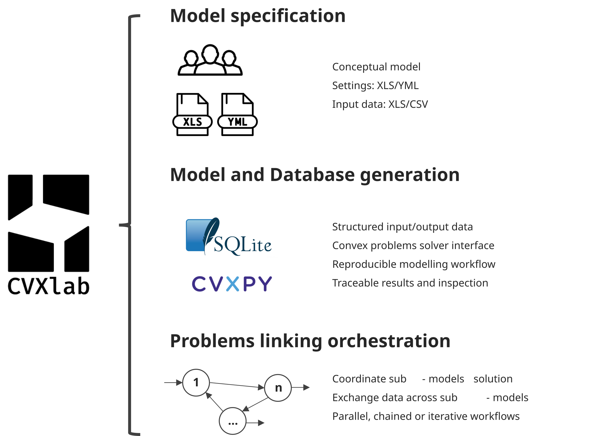
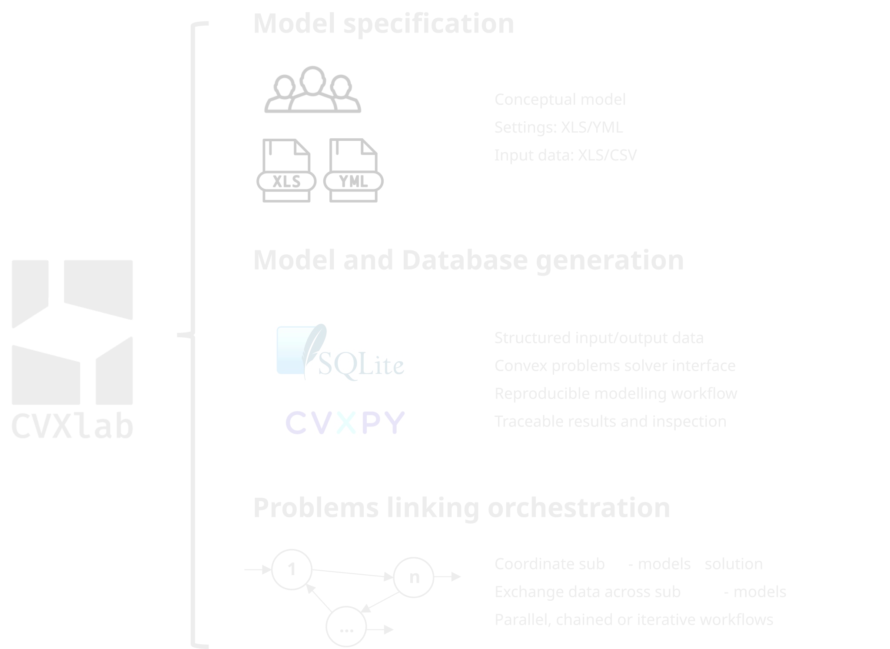

.. _user_guide:

User Guide
==========

This guide explains the complete CVXlab workflow for defining algebraic models,
preparing their data, solving numerical problems, and exporting results. Read
this page for an overview of all ten steps, then follow each step's link for
file formats, code examples, and configuration options.

For a first practical example, start with the :doc:`quick_start` or the
:ref:`production-planning tutorial <tutorial-production-planning>`. If you
prefer interactive prompts, the :ref:`guided_interface` provides a menu-driven
way to carry out the same workflow.

The diagram summarizes how model specification, data management, and solving
fit together, including workflows involving linked models.

.. _model_generation_from_scratch:

Modelling workflow
------------------

A new model follows the steps below in order. They are grouped into three
phases: define the model, prepare the model and data, then solve and inspect
results. When reopening an existing model, enter at step 4 as described there.
The left sidebar links to the detailed step pages; the right sidebar navigates
between the phases on this overview page.

Define the model
~~~~~~~~~~~~~~~~

.. rubric:: 1. Conceptual model definition

Define the mathematical structure before creating files: **sets** describe
model dimensions, **data tables** hold numerical data, **variables** refer to
those data, and **expressions and problems** describe the relationships to solve.
A problem may represent a system of equations or an optimization problem.

Details: :ref:`conceptual-model-definition`.

.. rubric:: 2. Create the model directory

Generate the model directory and its setup templates with
:py:func:`cvxlab.create_model_dir`. Choose YAML or Excel for the setup files;
optionally include Python templates for custom operators and constant types.

Details: :ref:`generation-of-model-directory`.

.. rubric:: 3. Fill the model setup files

Translate the conceptual model into definitions of sets, data tables, variables,
and problem expressions. Use the three YAML setup files or the corresponding
tabs in ``model_settings.xlsx``; both describe the same model structure.

Details: :ref:`fill-model-setup-files`.

Prepare the model and data
~~~~~~~~~~~~~~~~~~~~~~~~~~

.. rubric:: 4. Create or reopen the Model instance

Create a :py:class:`cvxlab.Model` instance to load and validate the setup files.
For a new model, the constructor generates ``sets.xlsx``; the Model instance
then provides the methods used throughout the remaining workflow.

Details: :ref:`generate-model-class-instance`.

.. _model_generation_from_existing:

.. admonition:: Starting with an existing model?

   Begin at step 4 with ``use_existing_data=True`` when the setup files,
   populated ``sets.xlsx``, model SQLite database, and input data files are
   already available. The constructor restores the model coordinates and
   initializes numerical problems using the data stored in SQLite.

   Skip the initial creation of set coordinates and blank data structures
   (steps 5 and 6). If you change input data files, follow steps 7 and 8 to
   refresh the database and numerical problems before solving again. Otherwise,
   continue to step 9. See :ref:`reusing-model-data` for the requirements.

.. rubric:: 5. Fill the set coordinates

Fill ``sets.xlsx`` with the members of each set, including any filters and
aggregation categories. These coordinates define the actual scope of the
model and the valid combinations represented in its data tables.

Details: :ref:`fill-sets-data`.

.. rubric:: 6. Initialize the data structures

Call :py:meth:`~cvxlab.Model.initialize_model_environment` to load the set
coordinates, validate variable definitions, and create the SQLite database
and blank Excel or CSV input files. These files contain the exogenous tables
that will receive numerical data in the next step.

Details: :ref:`data-structures-init`.

.. rubric:: 7. Fill or update exogenous data

Provide numerical values in the generated input tables, keeping the coordinate
columns unchanged. This is also the entry point for updating inputs in an
existing model; input files can be regenerated with
:py:meth:`~cvxlab.Model.generate_input_data_files` when needed.

Details: :ref:`fill-exogenous-data`.

Solve and inspect results
~~~~~~~~~~~~~~~~~~~~~~~~~

.. rubric:: 8. Initialize or refresh the numerical problems

Call :py:meth:`~cvxlab.Model.refresh_database_and_initialize_problem` to import
input data into SQLite, validate symbolic expressions, and prepare numerical
problems for solving. Repeat this step after changing input data files so that
the next solve uses the updated values.

Details: :ref:`numerical-problem-init`.

.. rubric:: 9. Solve the numerical problems

Run :py:meth:`~cvxlab.Model.run_model` with the solver and numerical settings
appropriate to the model. Choose ``parallel`` for independent problems,
``sequential`` for an ordered chain of problems with data exchange, or
``integrated`` for iterative coordination of linked sub-problems.

Details: :ref:`numerical-problem-run`.

.. rubric:: 10. Export and inspect results

After a successful solve, call
:py:meth:`~cvxlab.Model.load_results_to_database` to write results to the
endogenous tables in SQLite. Inspect the stored data directly or use external
analysis tools; the :ref:`model utilities <utilities>` help inspect model
properties and check results against a reference database.

Details: :ref:`export-model-results`.

Tools and further reading
-------------------------

- :ref:`Guided interface <guided_interface>`: perform the workflow through
  interactive prompts instead of calling each API directly.
- :ref:`Inspecting and managing models <utilities>`: inspect sets and variables,
  maintain database tables, and compare results with reference data.
- :ref:`Tutorials <tutorials>`: follow worked examples that apply these steps
  to specific modeling problems.
- :doc:`API reference <api_reference>`: look up signatures and options when
  implementing your own workflow.

.. toctree::
   :maxdepth: 1
   :hidden:
   :caption: Define the model

   1. Conceptual model definition <user_guide_steps/conceptual_model_definition>
   2. Create the model directory <user_guide_steps/model_directory_generation>
   3. Fill the model setup files <user_guide_steps/fill_model_setup_files>

.. toctree::
   :maxdepth: 1
   :hidden:
   :caption: Prepare the model and data

   4. Create or reopen the Model instance <user_guide_steps/generate_model_instance>
   5. Fill the set coordinates <user_guide_steps/fill_sets_data>
   6. Initialize the data structures <user_guide_steps/data_structures_init>
   7. Fill or update exogenous data <user_guide_steps/fill_exogenous_data>

.. toctree::
   :maxdepth: 1
   :hidden:
   :caption: Solve and inspect results

   8. Initialize or refresh numerical problems <user_guide_steps/numerical_problem_init>
   9. Solve the numerical problems <user_guide_steps/numerical_problem_run>
   10. Export and inspect results <user_guide_steps/export_model_results>

.. toctree::
   :maxdepth: 1
   :hidden:
   :caption: Tools

   Guided interface <guided_interface>
   Inspecting and managing models <model_utilities>

.. Add an Advanced topics toctree here when the first topic is available.
